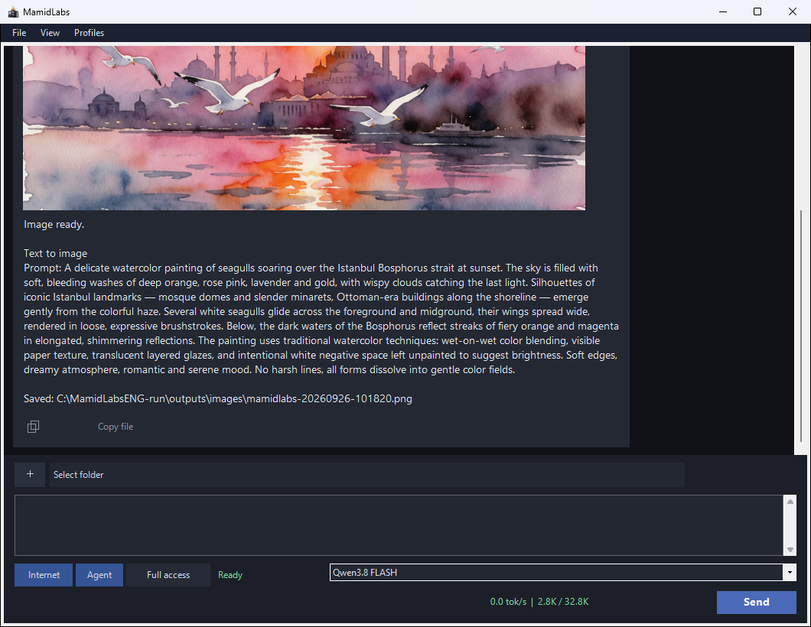
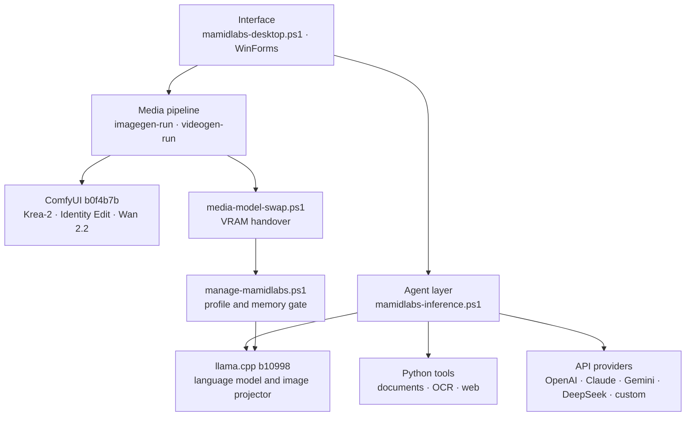
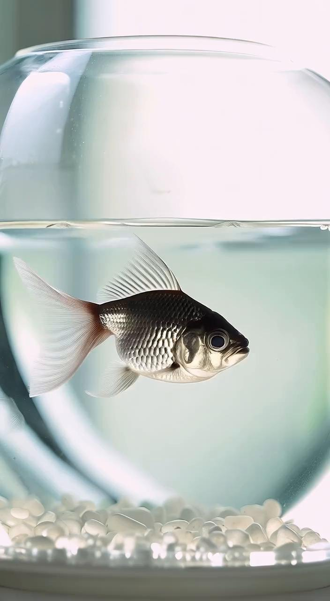

<p align="center">
  
</p>

<h1 align="center">MamidLabs</h1>

<p align="center">
  <a href="https://github.com/workaybarsh/MamidLabsTR"><b>For Türkçe</b></a>
</p>

<p align="center">
  <b>A fully local, multimodal AI workspace</b><br>
  Chat · Web search · Documents · OCR · Audio transcription · Image understanding · Image and video generation · Photo editing · Charts
</p>

<p align="center">
  
</p>

<p align="center">
  <a href="#features">Features</a> ·
  <a href="#hardware-profiles">Hardware profiles</a> ·
  <a href="#system-requirements">System requirements</a> ·
  <a href="#installation">Installation</a> ·
  <a href="#architecture">Architecture</a> ·
  <a href="#security">Security</a> ·
  <a href="#testing-and-verification">Testing and verification</a> ·
  <a href="#gallery">Gallery</a> ·
  <a href="#documentation">Documentation</a> ·
  <a href="#license">License</a>
</p>

MamidLabs brings chat, web search, reading and creating documents, OCR, audio transcription
(speech plus non-speech audio events), image understanding, and
image and video generation together in a single desktop window. The language, image and video models
run on the user's own graphics card. The internet is used only for installation, downloading models,
web search and optional API providers.

<p align="center">
  
</p>

## Features

| Capability | Description |
|---|---|
| **Chat** | Qwen3.8 27B (MAX/FLASH) or Qwen3.5 9B (LITE); 32K context, automatic context compaction |
| **Web search** | Search and page reading; sources cited in the answer |
| **Document reading** | PDF, Word, Excel, PowerPoint, ZIP and RAR |
| **Document creation** | PDF, Word and PowerPoint; with user approval |
| **OCR** | PaddleOCR: images on the GPU, scanned PDFs on the CPU |
| **Audio transcription** | faster-whisper large-v3 + Silero VAD; a microphone recording or audio file becomes chronological text |
| **Non-speech sounds** | AST (AudioSet) tags events such as footsteps or a door in parentheses; optional speaker diarization |
| **Image understanding** | The language model interprets the attached image directly |
| **Image generation** | Krea-2 Turbo; regeneration, style reference and a realism LoRA on request |
| **Photo editing** | Krea 2 Identity Edit: clothes, lighting and background change while the person's face is preserved; with two images it places the person into a scene (16 GB profiles) |
| **Video generation** | Wan 2.2 TI2V 5B; from text, from an image, and continuing from a video |
| **Chart drawing** | Bar, line, pie, scatter and function curves (y=f(x)); from a single chat request |
| **Agent mode** | Reading/writing files in a bound folder and running commands; with user approval |
| **API providers** | Optional OpenAI, Claude, Gemini, DeepSeek and a custom OpenAI-compatible endpoint; key verification and model listing |
| **Your own models** | Choose the language, image and video model by file path; the files are used in place without copying |

## Hardware profiles

| | MAX | FLASH | LITE |
|---|---|---|---|
| Target hardware | 16 GB VRAM · 32 GB RAM | 16 GB VRAM · 32 GB RAM | 8 GB VRAM · 16 GB RAM |
| Language model | Qwen3.8 27B IQ4_XS | Qwen3.8 27B IQ4_XS | Qwen3.5 9B Q5_K_M |
| Thinking | Deep | Short | Deep, unlimited (no budget) |
| Image model | Krea-2 Turbo fp8 | Krea-2 Turbo fp8 | Krea-2 Turbo GGUF Q4_K_M |
| Model download | ~52 GB (shared with FLASH) | ~52 GB | ~36 GB |
| Measured chat speed | ~42–58 tok/s | ~42–58 tok/s | ~97 tok/s (on 16 GB) |

MAX and FLASH use the same files; setup offers them as a single **Qwen3.8 27B** option and you switch
between them from the app's model bar. Measurement hardware: RTX 5060 Ti 16 GB (MTP on). LITE reaches
~97 tok/s on 16 GB; on an 8 GB card the same media pipeline is scaled down. Details:
[docs/technical-notes.md](docs/technical-notes.md).

## System requirements

- Windows 10 2004 or later, or Windows 11 (x64)
- An NVIDIA graphics card with a current driver: at least 8 GB VRAM for LITE, 16 GB for MAX/FLASH
- Free SSD space including the models: ~58 GB for LITE, ~75 GB for MAX/FLASH
- An internet connection during installation

If Python 3.10+, Git, 7-Zip or the Visual C++ Redistributable are missing, the setup wizard installs
them with winget.

## Installation

**One click:** download `MamidLabs_Setup.exe` from the
[latest release](https://github.com/workaybarsh/MamidLabsENG/releases/latest) and run it. The wizard
measures the computer, shows a **profile report** and recommends a suitable profile. You then choose
the profile (LITE or Qwen3.8 27B), optionally **leave the models for later**, or use **your own model
or API account**. Setup does not need administrator rights; the default folder is
`%LOCALAPPDATA%\Programs\MamidLabs`. Details: [docs/installation.md](docs/installation.md).

**By script:**

```powershell
git clone https://github.com/workaybarsh/MamidLabsENG.git C:\MamidLabs-src
powershell -ExecutionPolicy Bypass -File C:\MamidLabs-src\scripts\install-mamidlabs.ps1 -Profile lite
```

The script runs the preflight check, installs the bundled PowerShell 7, llama.cpp, the Python
environments and ComfyUI at pinned versions, and verifies the installation. Then open the app with the
**MamidLabs** desktop shortcut and download the models with **Profiles → Profile manager → Download
missing**.

**Updating:** Profiles → **Check for updates**. If a new version exists, **Update now** downloads and
opens the setup wizard and closes MamidLabs; chats, settings and models are kept.

**Uninstalling:** Settings → Apps → MamidLabs → Uninstall. Everything is deleted, including the
models, caches, chats and the prerequisites MamidLabs installed; the computer stays as if it had never
been installed.

## Architecture



The core principle: only one heavy model is in VRAM at a time. On an image or video request the
language model is stopped and reloaded after generation. By default ComfyUI runs only during media
generation (it holds neither VRAM nor RAM when idle); on LITE it can be kept open between media jobs
with `comfyKeepAlive=true`.

## Security

- While **Full access** is off, writing files, running commands and creating documents require user
  approval. If approval is not given within 10 minutes the action is rejected and the approval window
  closes itself.
- For rejected actions a model-independent "Nothing was done" note is added below the answer.
- Every tool call is written to the `logs\audit.jsonl` audit log; chat records and API keys are
  encrypted with Windows DPAPI.
- Web tools only reach public HTTP(S) addresses; local and private network addresses are rejected.
- The model does not create documents/images/videos/charts unless explicitly asked; `read_document` is
  offered only with an attached document or a file request. If a web search fails, or the internet is
  off for a current-information request, it reports the situation honestly instead of inventing an answer.

## Testing and verification

```powershell
python -m pip install pytest -r requirements\app.txt
python -m pytest -q
```

The behavior tests run the real PowerShell functions; if PowerShell 7 is not on PATH,
`tests/conftest.py` finds the bundled PowerShell 7 of an installed MamidLabs on its own. After
installation the components are also verified end to end with the real models:

```powershell
%LOCALAPPDATA%\Programs\MamidLabs\runtime\pwsh\pwsh.exe -File %LOCALAPPDATA%\Programs\MamidLabs\scripts\smoke-test.ps1 -Profile lite
```

## Gallery

The images and videos below were generated locally with MamidLabs.

<table>
  <tr>
    <td></td>
    <td></td>
    <td></td>
  </tr>
  <tr>
    <td></td>
    <td></td>
    <td></td>
  </tr>
  <tr>
    <td><a href="docs/media/video-boat.mp4"></a><br>Video · 832×480 · 3 s</td>
    <td><a href="docs/media/video-fish.mp4"></a><br>Video · 704×1280 · 2 s</td>
    <td><br>LITE profile, 8 GB</td>
  </tr>
</table>

## Documentation

| Document | Content |
|---|---|
| [docs/installation.md](docs/installation.md) | Installation, updating, verification, uninstalling and troubleshooting |
| [docs/technical-notes.md](docs/technical-notes.md) | Profiles, memory budget, media pipeline, tools and known notes |
| [AGENTS.md](AGENTS.md) | Infrastructure guide for developers and AI agents |
| [CHANGELOG.md](CHANGELOG.md) | Release history |

## License

The MamidLabs source code is proprietary and closed (private repository) and **All Rights Reserved**;
copyright is held by Aybars Haydar Altuntaş. It may not be used, copied, modified or distributed
without prior written permission. See the [LICENSE](LICENSE) file for details. The models used (Qwen, Krea 2, the Krea 2 Identity Edit LoRA, Wan 2.2 etc.) and third-party
components (llama.cpp, ComfyUI, ComfyUI-GGUF, comfyui-krea2edit etc.) are subject to their own
licenses; this license does not cover them.
